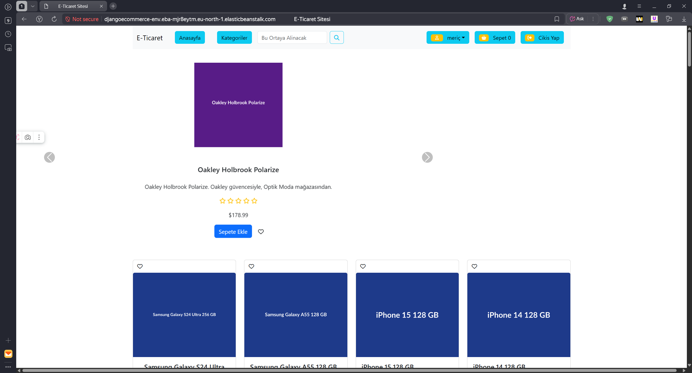
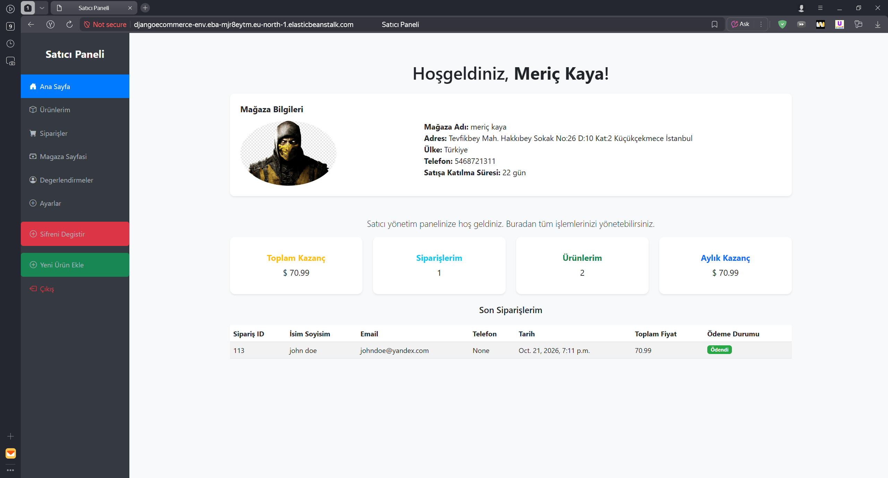
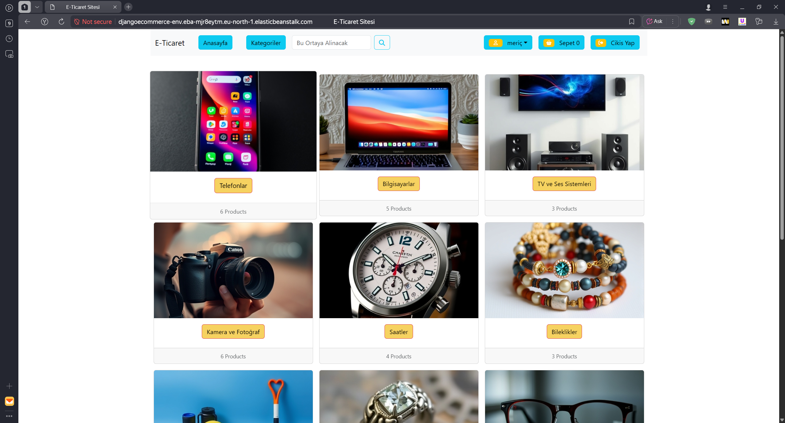
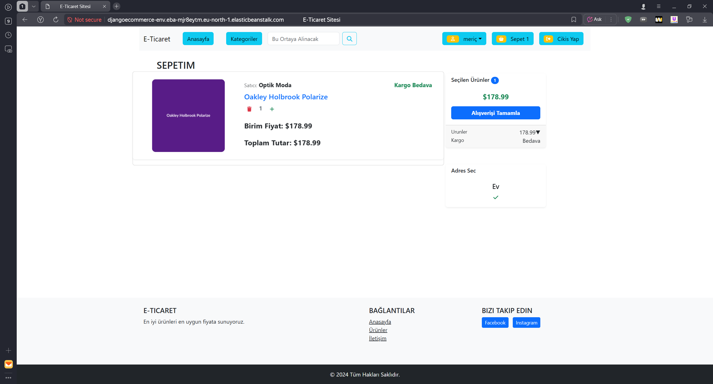
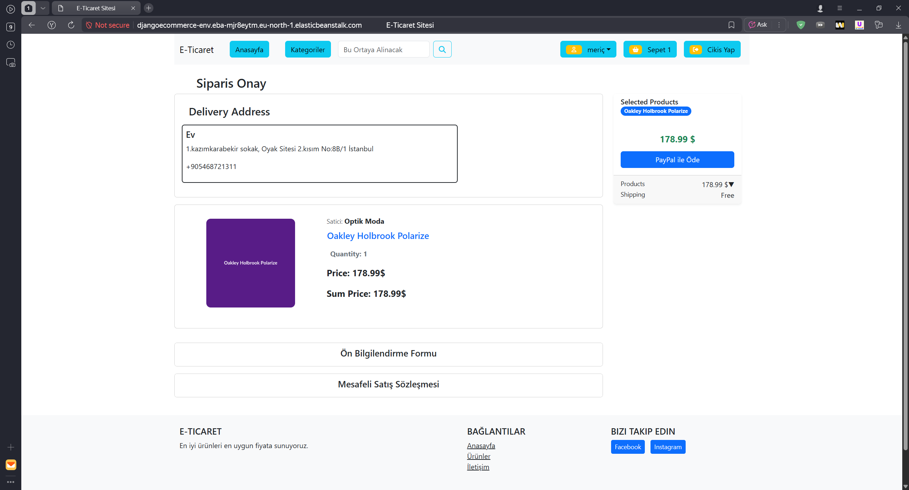
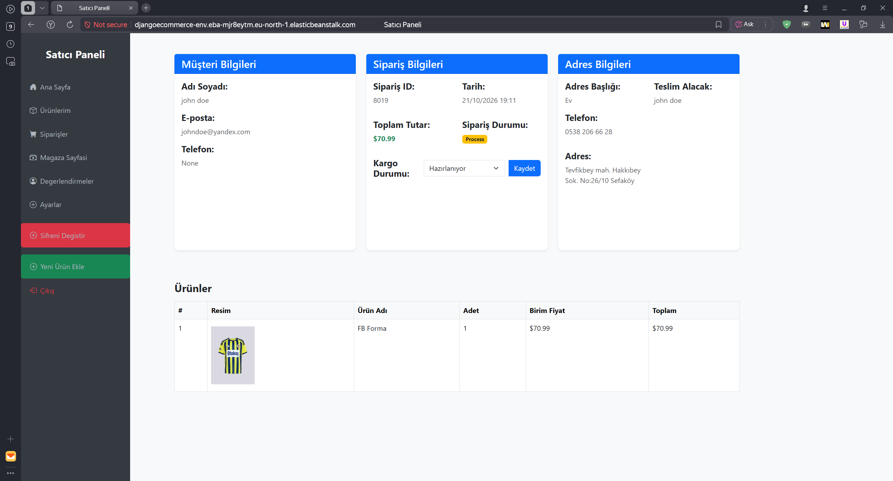

# E-COMMERCE-PRJ

[Türkçe](#türkçe) | [English](#english)

🔗 **Canlı Demo / Live Demo:** http://djangoecommerce-env.eba-mjr8eytm.eu-north-1.elasticbeanstalk.com/

### 🔑 Demo Hesaplar / Demo Accounts

Siteyi kayıt olmadan incelemek için aşağıdaki hesapları kullanabilirsiniz.
You can use the accounts below to explore the site without signing up.

| Hesap / Account | E-posta / Email | Şifre / Password |
|---|---|---|---|
| 🛒 Alıcı / Buyer | `demo.alici@example.com` | `DemoHesap2026!` |
| 🏪 Satıcı / Seller | `demo.satici@example.com` | `DemoHesap2026!` |

> Ödemeler PayPal Sandbox ile çalışır, gerçek para çekilmez.
> Payments use PayPal Sandbox, no real money is charged.

---

## Türkçe

Kullanıcıların internet üzerinden alışveriş yapmalarını sağlayan çok satıcılı bir e-ticaret sitesi projesi.

### Özellikler

- Kullanıcı kaydı ve girişi
- Ürün arama ve filtreleme
- Sepet işlemleri
- Ödeme (Checkout) işlemleri
- PayPal Sandbox
- Ürünlere yorum yapma, yıldız değerlendirmesi
- Müşteri ve satıcı adresleri
- Satıcı sayfası
- Ürün ekleme, düzenleme ve silme
- Kullanıcı bilgilerini düzenleme
- İstek listesi
- Kategori ve etiketler

### Kullanılan Teknolojiler

- HTML, CSS, JavaScript
- Ajax
- Bootstrap
- Python, Django
- MySQL (AWS RDS)
- AWS Elastic Beanstalk
- PayPal Sandbox

### Ortam Değişkenleri

Projeyi çalıştırmak için gereken değişkenler `.env.example` dosyasında listelenmiştir.

### İletişim

Meriç Kaya – [LinkedIn](https://www.linkedin.com/in/meri%C3%A7-kaya-883b08269/) – merickay0@yandex.com

---

## English

A multi-vendor e-commerce website project that allows users to shop online.

### Features

- User registration and login
- Product search and filtering
- Shopping cart operations
- Checkout process
- PayPal Sandbox
- Product reviews and star ratings
- Customer and seller addresses
- Seller page
- Adding, editing and deleting products
- Editing user information
- Wishlist
- Categories and tags

### Tech Stack

- HTML, CSS, JavaScript
- Bootstrap
- Python, Django
- MySQL (AWS RDS)
- AWS Elastic Beanstalk
- PayPal Sandbox

### Environment Variables

The variables required to run the project are listed in the `.env.example` file.

### Contact

Meriç Kaya – [LinkedIn](https://www.linkedin.com/in/meri%C3%A7-kaya-883b08269/) – merickay0@yandex.com
